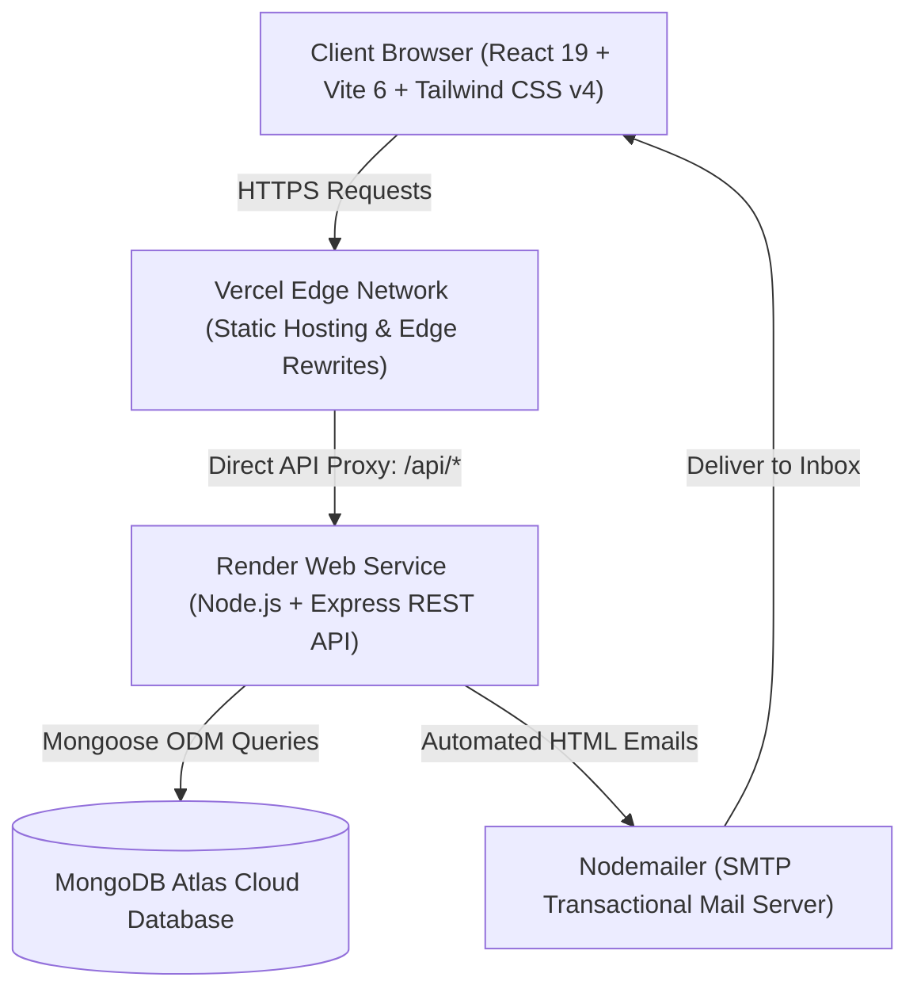

# 🇮🇳 Swadeshi for Atmanirbhar Bharat — Travel & Tourism Planner

[](https://swadeshi-for-atmanirbhar-bharat-tra.vercel.app/)
[](https://swadeshi-for-atmanirbhar-bharat-travel.onrender.com)
[](https://www.mongodb.com/cloud/atlas)
[](https://react.dev/)
[](https://tailwindcss.com/)
[](https://opensource.org/licenses/MIT)

> **Swadeshi Travel Planner** is an enterprise-grade full-stack web application designed to promote domestic Indian tourism in alignment with the national vision of **Atmanirbhar Bharat** (Self-Reliant India). Built on **React 19**, **Vite 6**, **Tailwind CSS v4**, **Node.js / Express**, and **MongoDB Atlas**, the platform features an intelligent **AI Trip Planner Chatbot**, 3D interactive visualizations, a multi-step booking pipeline, simulated payment gateways, automated email notifications, and an executive administrative management portal.

---

## 🌐 Live Deployments

| Service | Environment | Live Link | Status |
| :--- | :--- | :--- | :---: |
| **Frontend Application** | **Vercel Edge** | [https://swadeshi-for-atmanirbhar-bharat-tra.vercel.app/](https://swadeshi-for-atmanirbhar-bharat-tra.vercel.app/) |  |
| **REST API Backend** | **Render Web Service** | [https://swadeshi-for-atmanirbhar-bharat-travel.onrender.com](https://swadeshi-for-atmanirbhar-bharat-travel.onrender.com) |  |
| **Cloud Database** | **MongoDB Atlas Cluster** | `tour_planner` (AWS Mumbai Region) |  |

---

## 📖 Detailed Project Overview & Explanation

### 1. The Vision & Problem Statement
Traditional travel aggregators often favor high-commission commercial hotel chains and international packages, leaving domestic Indian circuits, cultural heritage sites, and local homestays underrepresented. Furthermore, travelers frequently face:
- **Itinerary Paralysis:** Spending hours scouring multiple blogs to figure out travel durations, day-wise plans, and budget allocations.
- **Hidden Costs:** Opaque pricing models where taxes, service charges, and companion fees appear at the last checkout screen.
- **Fragmented Workflows:** Booking hotels on one site, activities on another, and transit separately without a unified itinerary.

### 2. The Swadeshi Solution
**Swadeshi Travel Planner** eliminates these barriers by providing a unified, domestic-first platform that:
1. **Celebrates Incredible India:** Curates iconic and emerging Indian destinations—from the golden deserts of Rajasthan and serene backwaters of Kerala to the spiritual ghats of Varanasi and snow-clad valleys of Himachal.
2. **Provides Instant AI Itineraries:** Features an embedded **AI Trip Planner** that drafts custom day-wise schedules, transport recommendations (Train, Flight, Road), and expense breakdowns in seconds.
3. **Delivers End-to-End Execution:** Allows travelers to discover destinations, customize stay dates, manage companions, select adventure activities, and simulate payments in one seamless pipeline.
4. **Empowers Administrators:** Gives platform managers real-time control over bookings, customer reviews, support queries, and operational revenue metrics.

---

## 🏗️ System Architecture & Data Flow



### Architectural Highlights
- **Client-Side Routing:** Managed via **React Router v7** with Single-Page Application (SPA) efficiency and scroll-restoration.
- **Proxy Configuration:** `vercel.json` rewrites all `/api/*` traffic transparently to the Render backend web service, completely resolving Cross-Origin Resource Sharing (CORS) latency and errors.
- **Database Clustering:** Hosted on **MongoDB Atlas** with automated failover, replica sets, and strict schema validation through Mongoose.

---

## 🧩 Deep Dive into Core Functional Modules

### 🤖 1. Swadeshi AI Trip Planner & Itinerary Engine
The platform includes an intelligent travel assistant available on every page:
- **Dual Planning Modes:**
  - **Quick Itinerary Generator:** An interactive form taking destination, trip duration (1–15 days), budget style (Budget, Moderate, Luxury), travel party size, and transit preference (Train, Flight, Road).
  - **Conversational Assistant:** Direct chat interface answering regional travel questions, weather queries, packing tips, and local food specialties.
- **Algorithmic Output:**
  - Day-by-Day schedule (Morning, Afternoon, Evening highlights).
  - Realistic cost breakdown (Stay, Food, Sightseeing, Transit).
  - Must-try culinary delicacies and insider travel tips.
- **REST Endpoints:** Powered by `/api/chatbot/itinerary` and `/api/chatbot/message`.

### 🎨 2. Interactive 3D Frontend & Visual Experience
- **Three.js Particle Canvas:** Built with `@react-three/fiber` and `@react-three/drei` to render interactive floating 3D particle spheres responding to cursor movements.
- **Tailwind CSS v4 & Framer Motion:** Fluid spring transitions, glassmorphic dropdowns with click-outside detection, and parallax cards (`react-parallax-tilt`).
- **Rich Catalogs:** Dedicated views for curated Indian destinations, thrilling adventure activities (scuba diving, river rafting, desert safaris), and authentic heritage stays.

### 📅 3. Multi-Step Reservation Pipeline
- **Smart Date Engine:** Dynamic calendar date picker computing total trip duration and per-night accommodation rates in real time.
- **Companion Management:** Dynamic traveler registry with age verification and customized activity add-ons.
- **Live Price Aggregator:** Instant itemized calculation of base tariff, companion charges, activity fees, and taxes before checkout.

### 💳 4. Simulated Payment Gateway & QR Subsystem
- **Dynamic UPI QR Code:** Generates real-time scannable UPI QR codes using `qrcode.react` with exact transaction amount and booking references (`SWD-XXXXXX`).
- **Multi-Method Support:** Simulates Credit/Debit Cards, Net Banking, and Wallet settlements with instant status confirmation.

### 📧 5. Automated Transactional Email Subsystem
- **Nodemailer Integration:** Triggered automatically upon critical lifecycle events:
  - **Welcome Email:** Dispatched immediately upon user registration.
  - **Booking Confirmation:** Formatted responsive HTML receipt with booking reference, destination, check-in dates, and total amount paid.
  - **Password Recovery:** Time-sensitive One-Time Password (OTP) dispatched for account recovery.

### 🛡️ 6. Unified Administrative Control Center (`/admin`)
- **Executive KPI Dashboard:** Real-time metrics tracking Gross Booking Revenue (₹), Total Bookings, Active Users, and Customer Queries.
- **Booking Management Desk:** Admins can review incoming traveler reservations and update statuses (**Approve** or **Reject**) with instant database synchronization.
- **Customer Query Resolution Desk (`/admin/queries`):** Support tickets submitted by users (`/user-queries`) can be reviewed and resolved with administrative notes.

### 🔐 7. Cryptographic Security & Hardening
- **Bcrypt Hashing:** Passwords hashed with cryptographic salt (10 rounds) via `bcryptjs`.
- **Zero Plain-Text Storage:** Strict schema definitions and database cleanup scripts completely prevent plain-text password exposure.
- **Protected Routing:** Token-based authentication guards admin dashboards and private booking histories.

---

## 🛠️ Complete Tech Stack

| Layer | Technologies | Purpose |
| :--- | :--- | :--- |
| **Frontend Framework** | **React 19**, **Vite 6** | Ultra-fast client-side rendering & optimized bundling |
| **Routing** | **React Router v7** | Client-side declarative routing & protected route guards |
| **Styling** | **Tailwind CSS v4** | Modern utility-first CSS engine with dark neon themes |
| **Animations & 3D** | **Framer Motion**, **Three.js**, `@react-three/fiber` | Spring physics, particle canvas, and interactive UI |
| **Icons & UI** | **React Icons**, **Lucide React**, `qrcode.react` | Vector iconography and dynamic QR code generation |
| **Backend Framework** | **Node.js (ES Modules)**, **Express.js** | Scalable REST API architecture and route handlers |
| **Database & ODM** | **MongoDB Atlas Cloud**, **Mongoose** | High-availability cloud document store and schemas |
| **Authentication & Crypto**| **Bcrypt.js** (Salt factor 10) | One-way cryptographic password hashing |
| **Email Services** | **Nodemailer** (SMTP) | Automated transactional HTML email dispatch |
| **Cloud Hosting & CI/CD** | **Vercel** & **Render** | Edge static hosting, serverless rewrites, and 24/7 web services |

---

## 📊 Pre-Seeded Production Dataset

To reflect enterprise-scale operations, the database is pre-seeded with verified real-world Indian travel data via `backend/seedLargeDataset.js`:

| Dataset Category | Record Count | Sample Scope |
| :--- | :---: | :--- |
| **Registered Travelers** | **84 Profiles** | Realistic Indian user profiles with encrypted bcrypt credentials |
| **Reservations & Trips** | **120 Bookings** | Historic, confirmed, and upcoming bookings across Indian circuits |
| **Traveler Reviews** | **66 Reviews** | Star ratings and authentic customer feedback on destinations |
| **Support Desk Inquiries** | **50 Queries** | Customer support tickets with official administrative responses |

---

## 🔌 REST API Endpoints Specification

### Authentication & User Routes (`/api/auth`)
| Method | Endpoint | Description | Auth Required |
| :--- | :--- | :--- | :---: |
| `POST` | `/api/auth/register` | Register new user account with bcrypt hashing | No |
| `POST` | `/api/auth/login` | Authenticate user credentials and return session token | No |
| `POST` | `/api/auth/forgot-password` | Generate and dispatch email OTP token | No |
| `POST` | `/api/auth/verify-otp` | Validate recovery OTP | No |
| `POST` | `/api/auth/reset-password` | Update password with new bcrypt hash | No |

### AI Trip Planner Routes (`/api/chatbot`)
| Method | Endpoint | Description | Auth Required |
| :--- | :--- | :--- | :---: |
| `POST` | `/api/chatbot/itinerary` | Generate tailored day-wise itinerary & expense plan | No |
| `POST` | `/api/chatbot/message` | AI travel conversational assistant | No |

### Booking Routes (`/api/bookings`)
| Method | Endpoint | Description | Auth Required |
| :--- | :--- | :--- | :---: |
| `POST` | `/api/bookings` | Create a new reservation with companions | Yes |
| `GET` | `/api/bookings/my-bookings` | Fetch logged-in user's reservation history | Yes |
| `GET` | `/api/bookings/:id` | Fetch detailed booking receipt | Yes |

### Administrative Routes (`/api/admin`)
| Method | Endpoint | Description | Auth Required |
| :--- | :--- | :--- | :---: |
| `GET` | `/api/admin/stats` | Fetch total platform turnover, users, and booking counts | Yes (Admin) |
| `GET` | `/api/admin/bookings` | Retrieve all reservations across the platform | Yes (Admin) |
| `PATCH`| `/api/admin/bookings/:id/status`| Approve or Reject reservation status | Yes (Admin) |
| `GET` | `/api/admin/users` | List all registered user accounts | Yes (Admin) |

### Support & Reviews Routes (`/api/queries`, `/api/reviews`)
| Method | Endpoint | Description | Auth Required |
| :--- | :--- | :--- | :---: |
| `POST` | `/api/queries` | Submit customer support inquiry | Yes |
| `GET` | `/api/queries/all` | Fetch all support tickets (Admin review) | Yes (Admin) |
| `GET` | `/api/reviews` | Retrieve approved destination traveler reviews | No |
| `POST` | `/api/reviews` | Submit new star rating and feedback | Yes |

---

## 📁 Repository Directory Tree

```
├── Frontend/                 # React 19 + Vite 6 Client Application
│   ├── src/
│   │   ├── assets/           # Team photos, logos, static illustrations
│   │   ├── components/       # Reusable UI (Navbar, Hero, Chatbot, 3D Canvas, Footer)
│   │   ├── pages/            # Page Views (BookingPage, AdminDashboard, Reviews, Auth)
│   │   ├── config/           # Centralized API routing configuration (api.js)
│   │   ├── data/             # Curated destination, stay, and activity catalogs
│   │   └── App.jsx           # Main client routing & React Context Provider
│   ├── package.json
│   └── vite.config.js        # Vite build configuration with development proxy
│
├── backend/                  # Node.js + Express.js REST API
│   ├── config/               # Database connection (Mongoose / MongoDB Atlas)
│   ├── models/               # Schemas: User.js, Booking.js, Query.js, Review.js
│   ├── routes/               # API route handlers: auth, booking, admin, chatbot, query
│   ├── utils/                # Nodemailer email dispatcher & HTML email templates
│   ├── server.js             # Standalone Express server entry point
│   ├── createAdmin.js        # CLI utility to create administrative accounts
│   ├── seedLargeDataset.js   # Production dataset seeder script
│   └── package.json
│
├── vercel.json               # Vercel proxy rewrites (/api/* -> Render Web Service)
├── netlify.toml              # Netlify serverless fallback configuration
└── README.md                 # Project documentation
```

---

## ⚡ Getting Started Locally

### 1. Prerequisites
- [Node.js](https://nodejs.org/) (v18 or higher recommended)
- [MongoDB](https://www.mongodb.com/) (Local instance or free [MongoDB Atlas](https://www.mongodb.com/cloud/atlas) cluster)
- Git

### 2. Clone the Repository
```bash
git clone https://github.com/satyamsharma804/Swadeshi-for-Atmanirbhar-Bharat---Travel-Tourism.git
cd Swadeshi-for-Atmanirbhar-Bharat---Travel-Tourism
```

### 3. Backend Setup
1. Navigate to the backend directory:
   ```bash
   cd backend
   npm install
   ```

2. Create a `.env` file in the `backend/` directory:
   ```env
   PORT=3000
   NODE_ENV=development
   MONGODB_URI=mongodb+srv://<user>:<password>@cluster.mongodb.net/tour_planner?retryWrites=true&w=majority
   CORS_ORIGIN=http://localhost:5173

   # Email Service (Optional for local testing)
   EMAIL_HOST=smtp.gmail.com
   EMAIL_PORT=587
   EMAIL_USER=your-email@gmail.com
   EMAIL_PASSWORD=your-app-password
   EMAIL_FROM="Swadeshi Travel <your-email@gmail.com>"
   ```

3. (Optional) Populate database with realistic mock data:
   ```bash
   node seedLargeDataset.js
   ```

4. Start the backend development server:
   ```bash
   npm run dev
   # Backend running on http://localhost:3000
   ```

### 4. Frontend Setup
1. Open a new terminal and navigate to the frontend:
   ```bash
   cd Frontend
   npm install
   ```

2. Start the Vite development server:
   ```bash
   npm run dev
   # Frontend running on http://localhost:5173
   ```

3. Open `http://localhost:5173` in your browser. The Vite proxy forwards `/api` calls directly to `http://localhost:3000`.

---

## 🔑 Demonstration Credentials

For testing and grading purposes, you can log in using the pre-configured accounts:

| Role | Email | Password | Access Capabilities |
| :--- | :--- | :--- | :--- |
| **Platform Administrator** | `admin@example.com` | `admin123` | Full Admin Dashboard, Revenue Analytics, Booking Approvals (`/admin`) |
| **Registered Traveler** | `rajesh.kumar@example.com` | `password123` | Booking Pipeline, Profile Management, Personal Bookings (`/profile`) |

---

## 👥 Meet Our Team

| Name | Role | Academic Background | Professional Links |
| :--- | :--- | :--- | :--- |
| **Satyam Kumar** | **Lead & Backend Developer** | B.Tech CSE (4th Year), Lovely Professional University | [](https://www.linkedin.com/in/satyam-kumar-51a413299/) [](https://github.com/satyamsharma804) |

---

## 📄 License

This project is licensed under the [MIT License](LICENSE) — free to use and adapt for academic, personal, and community development.
